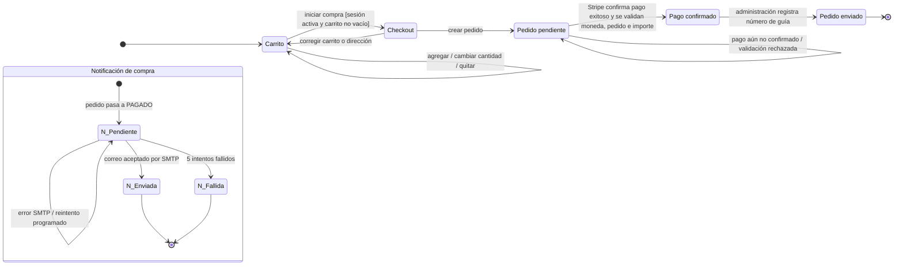

# Diagrama de estados del proyecto

El diagrama muestra el ciclo de vida del pedido que coordina el flujo de compra. Las transiciones reflejan el código actual; los estados `RECHAZADO`, `CANCELADO` y `ENTREGADO` existen en el modelo, pero no se encontró una operación que los active.

## Lectura del flujo

- El carrito persiste por sesión; agregar productos no reserva ni descuenta existencias.
- El pedido se crea en estado `PENDIENTE`. Solo pasa a `PAGADO` tras verificar con Stripe que el pago fue exitoso y coincide con el pedido.
- Desde `PAGADO`, administración guarda una guía y el pedido cambia a `ENVIADO`.
- Al confirmar el pago se registra una notificación pendiente. El correo requiere que las notificaciones y SMTP estén habilitados; los errores se reintentan hasta cinco veces.
- Aunque el modelo declara `RECHAZADO`, `CANCELADO` y `ENTREGADO`, no están conectados a transiciones en el flujo actual.
