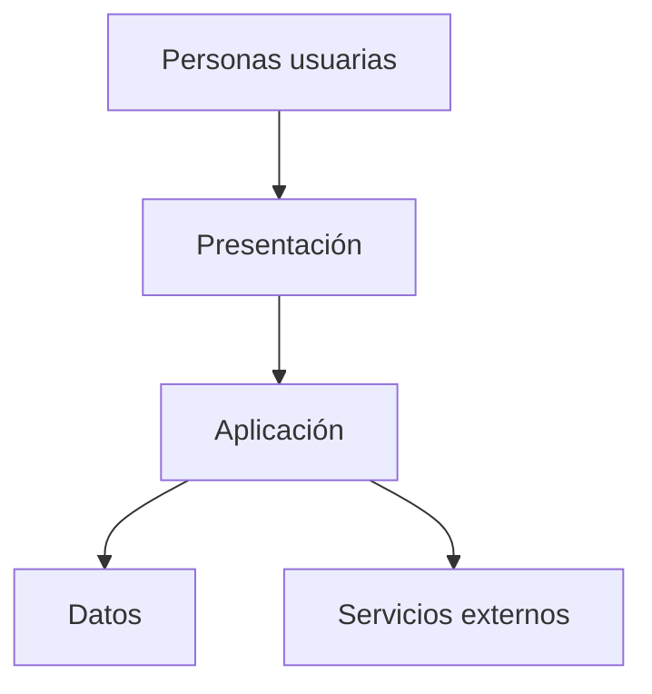

# Estructura lógica del proyecto

- **Personas usuarias:** interactúan con el sistema según sus permisos.
- **Presentación:** muestra información y recoge las acciones de las personas.
- **Aplicación:** coordina las operaciones, aplica reglas y controla el acceso.
- **Datos:** conserva la información necesaria para el funcionamiento del sistema.
- **Servicios externos:** apoyan operaciones delegadas, como el envío de notificaciones.

La información y las acciones fluyen desde la presentación hacia la aplicación; esta consulta o actualiza los datos y se comunica con servicios externos cuando hace falta.
